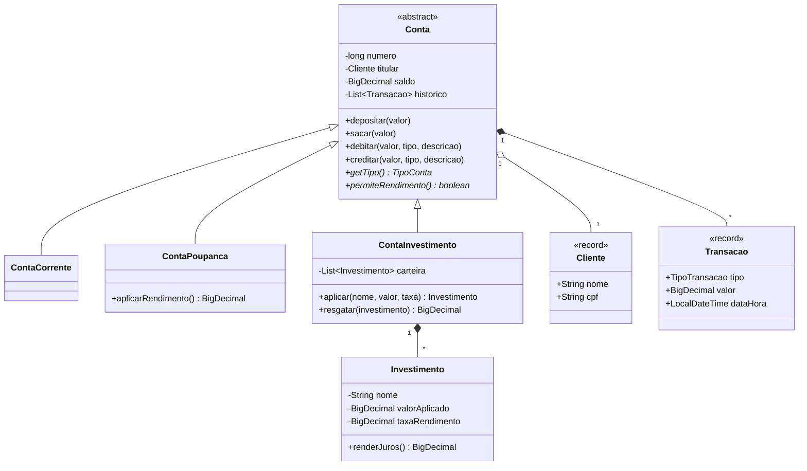

# Transactional Controller — Controle de Transações Financeiras com POO

Aplicativo de console, em Java, que simula um sistema bancário básico. O projeto
foi construído como laboratório prático para consolidar os pilares da
**Programação Orientada a Objetos** — herança, encapsulamento, polimorfismo,
abstração e reuso de código — além de boas práticas modernas da linguagem como
**Lombok**, **enums** e **records**.

A aplicação permite criar contas, depositar, sacar, transferir via **PIX**,
criar **investimentos** e acompanhar o **histórico de transações** de cada conta.

---

## Sumário

- [Funcionalidades](#funcionalidades)
- [Conceitos de POO aplicados](#conceitos-de-poo-aplicados)
- [Arquitetura e estrutura do projeto](#arquitetura-e-estrutura-do-projeto)
- [Modelo de domínio](#modelo-de-domínio)
- [Como executar](#como-executar)
- [Exemplo de uso](#exemplo-de-uso)
- [Decisões técnicas](#decisões-técnicas)
- [Possíveis evoluções](#possíveis-evoluções)

---

## Funcionalidades

- **Abertura de contas** em três modalidades: Corrente, Poupança e Investimento.
- **Depósito** e **saque** com validação de valor e de saldo.
- **Transferência via PIX** entre contas (débito na origem, crédito no destino).
- **Aplicação de investimentos** em uma carteira vinculada à conta de investimento.
- **Rendimentos**: poupança rende sobre o saldo; conta de investimento rende sobre
  a carteira.
- **Extrato / histórico** imutável de todas as transações de uma conta.
- **Listagem** de todas as contas cadastradas.
- Menu interativo via console com tratamento de erros de regra de negócio.

---

## Conceitos de POO aplicados

| Pilar | Onde aparece no projeto |
|-------|-------------------------|
| **Abstração** | A classe abstrata `Conta` define o contrato comum (depositar, sacar, histórico) sem conhecer o tipo concreto. |
| **Herança** | `ContaCorrente`, `ContaPoupanca` e `ContaInvestimento` estendem `Conta` e reaproveitam todo o comportamento base. |
| **Encapsulamento** | `saldo` e `historico` são privados; só mudam por métodos controlados. O histórico é exposto como lista imutável. |
| **Polimorfismo** | `getTipo()` e `permiteRendimento()` são especializados por cada subclasse; o serviço trata as contas de forma genérica e usa *pattern matching* (`instanceof`) quando precisa do comportamento específico. |
| **Composição** | `ContaInvestimento` é composta por uma carteira de objetos `Investimento`. |
| **Reuso de código** | O `ContaService` e o `ContaRepository` centralizam regras e persistência, evitando duplicação. |

---

## Arquitetura e estrutura do projeto

O projeto segue uma separação simples em camadas, com o fluxo de dependências
apontando do console para o domínio:

```
UI (console)  ->  Service (regras)  ->  Repository (persistência em memória)  ->  Domain (entidades)
```

```
transactional-controller/
├── pom.xml                         # Build Maven + Lombok
├── mvnw / mvnw.cmd / .mvn/         # Maven Wrapper (build sem Maven instalado)
├── images/                         # Capturas de tela (opcional)
└── src/main/java/io/github/gtvnv/transactional/
    ├── Main.java                   # Ponto de entrada; monta as dependências
    ├── domain/
    │   ├── Conta.java              # Classe abstrata base (abstração/encapsulamento)
    │   ├── ContaCorrente.java      # Herança + polimorfismo
    │   ├── ContaPoupanca.java      # Herança + rendimento especializado
    │   ├── ContaInvestimento.java  # Herança + composição com Investimento
    │   ├── Investimento.java       # Entidade de aplicação (Lombok @Getter)
    │   ├── Cliente.java            # record — dado imutável do titular
    │   ├── Transacao.java          # record — lançamento imutável do histórico
    │   ├── TipoConta.java          # enum — tipos de conta
    │   ├── TipoTransacao.java      # enum — natureza das transações
    │   └── exception/
    │       └── RegraNegocioException.java
    ├── repository/
    │   └── ContaRepository.java    # Persistência simulada em memória
    ├── service/
    │   └── ContaService.java       # Casos de uso e regras de negócio
    └── ui/
        └── MenuConsole.java        # Menu e fluxo interativo
```

---

## Modelo de domínio



---

## Como executar

### Pré-requisitos

- **JDK 17+** (o projeto compila para o bytecode do Java 17).
- Não é necessário ter o Maven instalado: o projeto inclui o **Maven Wrapper**.

### Compilar e empacotar

No Linux/macOS:

```bash
./mvnw clean package
```

No Windows:

```powershell
.\mvnw.cmd clean package
```

Isso gera o jar executável em `target/transactional-controller.jar`.

### Rodar

Via jar empacotado:

```bash
java -jar target/transactional-controller.jar
```

Ou direto pelo plugin do Maven:

```bash
./mvnw exec:java
```

---

## Exemplo de uso

Ao iniciar, o menu é exibido no console:

```
==============================================
   CONTROLE DE TRANSACOES FINANCEIRAS (POO)
==============================================
----------------------------------------------
 1 - Abrir conta
 2 - Depositar
 3 - Sacar
 4 - Transferir via PIX
 5 - Aplicar investimento
 6 - Aplicar rendimentos
 7 - Ver extrato / historico
 8 - Listar contas
 0 - Sair
----------------------------------------------
Escolha uma opcao:
```

Um extrato, após algumas operações, fica assim:

```
---------- EXTRATO ----------
Conta Corrente n.1001 | titular: Gustavo | saldo: 749.50
Historico de transacoes:
  [07/11/2026 14:45:45] Deposito em conta            R$ 1000
  [07/11/2026 14:45:45] PIX enviado para conta 1002  R$ 250.50
-----------------------------
```

> Dica: salve capturas de tela da sua execução na pasta `images/` e referencie-as
> aqui para enriquecer a documentação.

---

## Decisões técnicas

- **`BigDecimal` para valores monetários**: evita os erros de arredondamento
  típicos de `double`/`float` em cálculos financeiros.
- **`record` para `Cliente` e `Transacao`**: representam dados imutáveis; o
  `record` reduz boilerplate e deixa a imutabilidade explícita.
- **`enum` para `TipoConta` e `TipoTransacao`**: tipagem forte para conjuntos
  fixos de valores, com descrição amigável embutida.
- **Lombok (`@Getter`)**: remove getters repetitivos mantendo o encapsulamento.
- **Histórico imutável**: `getHistorico()` devolve uma `List` não modificável,
  protegendo o estado interno da conta.
- **Persistência em memória**: o `ContaRepository` simula um banco de dados com
  uma coleção, isolando o acesso a dados do resto da aplicação.
- **Maven Wrapper**: garante que o projeto seja compilável mesmo em máquinas sem
  Maven instalado, fixando a versão da ferramenta.

---

## Possíveis evoluções

- Persistência real (arquivo ou banco de dados) por trás da interface do repositório.
- Autenticação de titular e extrato por período.
- Testes automatizados (JUnit) para as regras de negócio.
- Taxas e limites configuráveis por tipo de conta.

---

## Licença

Projeto de uso educacional, livre para estudo e adaptação.
